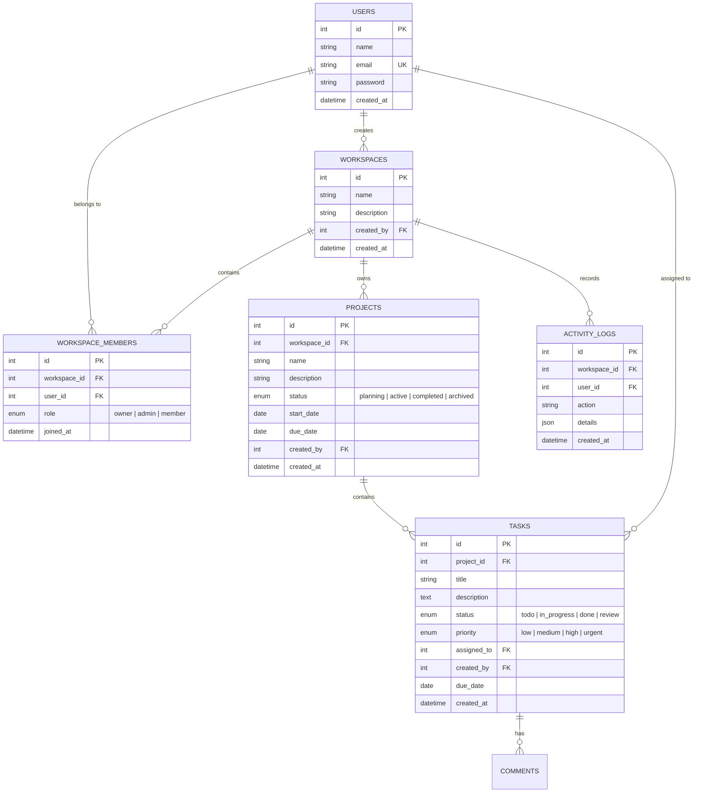

<div align="center">

# 🌐 WorkSphere — Full-Stack SaaS Platform
### *One Workspace. Every Project. Complete Control.*

[](https://nodejs.org/)
[](https://expressjs.com/)
[](https://www.mysql.com/)
[](https://react.dev/)
[](https://tailwindcss.com/)
[](http://localhost:5000/api/docs)
[](#automated-testing)
[](LICENSE)

<br/>

**WorkSphere** is a commercial-grade, multi-tenant Workspace, Project, and Task Management SaaS platform engineered for agile engineering teams. Built with a decoupled architecture featuring an Express.js REST API with connection pooling and a React 19 single-page application.

[Explore Swagger API Docs](http://localhost:5000/api/docs) • [API Health Check](http://localhost:5000/api/health) • [Frontend Client](http://localhost:5173)

</div>

---

## 📑 Table of Contents
- [Executive Overview](#-executive-overview)
- [Key Features](#-key-features)
- [System Architecture](#-system-architecture)
- [Database Schema & ERD](#-database-schema--erd)
- [RESTful API Reference](#-restful-api-reference)
- [Security & Hardening](#-security--hardening)
- [Getting Started & Installation](#-getting-started--installation)
- [Environment Configuration](#-environment-configuration)
- [Automated Testing](#-automated-testing)
- [Repository Structure](#-repository-structure)
- [Contributing & License](#-contributing--license)

---

## 🎯 Executive Overview

WorkSphere eliminates tool fragmentation by consolidating company workspaces, team hierarchies, project tracking, interactive Kanban task management, and chronological audit trails into a single high-performance platform.

### Core Value Pillars
- **Strict Multi-Tenancy:** Isolated data boundaries across multiple organizations or divisions.
- **Role-Based Access Control (RBAC):** Hierarchical permissions (`owner`, `admin`, `member`) enforced on every protected route.
- **Interactive Kanban Boards:** Dynamic task progression with real-time state synchronization.
- **Enterprise Audit Trail:** Automated activity logging capturing all project updates, status transitions, and member lifecycle events.
- **Self-Documenting REST API:** Live OpenAPI 3.0 / Swagger UI interface for developer onboarding.

---

## ✨ Key Features

| Domain | Capability | Description |
|---|---|---|
| **Authentication** | JWT Bearer Tokens | Secure stateless authentication with bcrypt password hashing (10 salt rounds) and automatic token expiry. |
| **Workspaces** | Multi-Tenant Scoping | Workspace provisioning, member invitation via email, role reassignment, and soft member removal. |
| **Projects** | Milestone Management | Project creation, status tracking (`planning`, `active`, `completed`, `archived`), and start/due dates. |
| **Tasks** | Kanban Workflows | Drag-and-click status transitions (`todo`, `in_progress`, `done`, `review`), priority levels (`low`, `medium`, `high`, `urgent`), and assignees. |
| **Activity** | Chronological Logs | Real-time workspace audit stream capturing task actions, member invitations, and milestone completions. |
| **Security** | Defensive Hardening | Rate limiting via `express-rate-limit`, secure HTTP headers with `helmet`, CORS validation, and SQL injection prevention via parameterized queries. |
| **Frontend** | Modern SaaS UI | Responsive landing page, collapsible sidebar navigation, live charts via Recharts, and Inter typography. |

---

## 🏗️ System Architecture

```text
┌────────────────────────────────────────────────────────┐
│               WorkSphere Frontend (React 19)           │
│       Vite • Tailwind CSS v4 • TanStack Query • Axios   │
└───────────────────────────┬────────────────────────────┘
                            │ HTTP JSON / Bearer JWT
                            ▼
┌────────────────────────────────────────────────────────┐
│             WorkSphere API (Node.js / Express)         │
│   Rate Limiter • Helmet • CORS • Zod Request Validator │
└─────────────┬───────────────────────────┬──────────────┘
              │                           │
              ▼                           ▼
┌───────────────────────────┐ ┌───────────────────────────┐
│     Auth & RBAC Guards    │ │  OpenAPI 3.0 / Swagger UI │
│   JWT Verify • Role Check │ │    /api/docs Endpoint     │
└─────────────┬─────────────┘ └───────────────────────────┘
              │
              ▼
┌────────────────────────────────────────────────────────┐
│                 MySQL Connection Pool                  │
│       Parameterized SQL Queries • Foreign Key Cascades │
│    [users] ──< [workspace_members] >── [workspaces]    │
│                     │                       │          │
│                     ▼                       ▼          │
│                  [tasks] <──────────── [projects]      │
│                     │                       │          │
│                     ▼                       ▼          │
│                 [comments]            [activity_logs]  │
└────────────────────────────────────────────────────────┘
```

---

## 🗄️ Database Schema & ERD

The relational database architecture is hosted on **MySQL 8.0+** using normalized tables, index optimization, and strict foreign-key cascading:



---

## 📡 RESTful API Reference

All protected endpoints require an `Authorization: Bearer <token>` header.

### 1. Authentication (`/api/auth`)
| Method | Endpoint | Description | Auth Required |
|---|---|---|:---:|
| `POST` | `/api/auth/register` | Register new user account | No |
| `POST` | `/api/auth/login` | Authenticate user & return JWT | No |
| `GET` | `/api/auth/profile` | Retrieve active authenticated user profile | **Yes** |

### 2. Workspaces (`/api/workspaces`)
| Method | Endpoint | Description | Auth Required | Min Role |
|---|---|---|:---:|:---:|
| `GET` | `/api/workspaces` | List all workspaces for authenticated user | **Yes** | Any |
| `POST` | `/api/workspaces` | Create new organization workspace | **Yes** | User |
| `GET` | `/api/workspaces/:id` | Get workspace details | **Yes** | Member |
| `PUT` | `/api/workspaces/:id` | Update workspace attributes | **Yes** | Admin |
| `DELETE` | `/api/workspaces/:id` | Delete workspace and cascade | **Yes** | Owner |
| `GET` | `/api/workspaces/:id/members` | List workspace members and roles | **Yes** | Member |
| `POST` | `/api/workspaces/:id/members` | Invite new member by email | **Yes** | Admin |
| `DELETE` | `/api/workspaces/:id/members/:userId` | Remove member from workspace | **Yes** | Admin |
| `GET` | `/api/workspaces/:id/activities` | List chronological workspace audit logs | **Yes** | Member |

### 3. Projects (`/api/workspaces/:id/projects`)
| Method | Endpoint | Description | Auth Required | Min Role |
|---|---|---|:---:|:---:|
| `GET` | `/api/workspaces/:id/projects` | List projects with status/search filters | **Yes** | Member |
| `POST` | `/api/workspaces/:id/projects` | Create a new project in workspace | **Yes** | Admin |
| `GET` | `/api/workspaces/:id/projects/:projectId` | Get project detail & metrics | **Yes** | Member |
| `PUT` | `/api/workspaces/:id/projects/:projectId` | Update project metadata or status | **Yes** | Admin |
| `DELETE` | `/api/workspaces/:id/projects/:projectId` | Delete project and cascade tasks | **Yes** | Admin |

### 4. Tasks (`/api/workspaces/:id/projects/:projectId/tasks` & `/api/tasks`)
| Method | Endpoint | Description | Auth Required |
|---|---|---|:---:|
| `GET` | `/api/workspaces/:id/projects/:projectId/tasks` | List tasks by project (Kanban board) | **Yes** |
| `POST` | `/api/workspaces/:id/projects/:projectId/tasks` | Create task with priority & assignee | **Yes** |
| `GET` | `/api/tasks/:taskId` | Get detailed task information | **Yes** |
| `PUT` | `/api/tasks/:taskId` | Update task details, status, or assignee | **Yes** |
| `DELETE` | `/api/tasks/:taskId` | Delete task | **Yes** |
| `GET` | `/api/tasks/:taskId/comments` | List comments on task | **Yes** |
| `POST` | `/api/tasks/:taskId/comments` | Add comment to task | **Yes** |
| `GET` | `/api/user/tasks` | List all tasks assigned to current user | **Yes** |

### 5. System & Health
| Method | Endpoint | Description |
|---|---|---|
| `GET` | `/api/health` | Service uptime and timestamp check |
| `GET` | `/api/docs` | Interactive OpenAPI 3.0 / Swagger UI console |

---

## 🛡️ Security & Hardening

- **Input Validation:** Every mutation payload is strictly parsed and sanitized against strict **Zod** schemas before reaching controllers.
- **SQL Injection Prevention:** 100% of queries use MySQL prepared statements with parameterized placeholders (`?`).
- **Cryptographic Hashing:** Passwords hashed with `bcrypt` (10 rounds) before persistence; plaintext passwords are never logged or stored.
- **Rate Limiting:** `express-rate-limit` prevents brute-force attacks on auth endpoints (15-min sliding window).
- **HTTP Security Headers:** `helmet` applies Content Security Policy, frameguard, and XSS filtering.
- **CORS Configuration:** Explicit origin whitelist protecting API consumers.

---

## 🚀 Getting Started & Installation

### Prerequisites
- **Node.js**: v18.0.0 or higher
- **npm**: v9.0.0 or higher
- **MySQL Server**: v8.0 or higher running locally or in the cloud

### 1. Clone Repository
```bash
git clone https://github.com/neerajcoder1/WorkspaceAPI.git
cd WorkspaceAPI
```

### 2. Backend Setup
```bash
# Install backend dependencies
npm install

# Configure environment variables
cp .env.example .env
# Edit .env with your MySQL credentials and JWT secret
```

### 3. Database Initialization
Ensure your MySQL instance is running, then create the database schema:
```sql
CREATE DATABASE IF NOT EXISTS worksphere_db;
USE worksphere_db;

CREATE TABLE IF NOT EXISTS users (
  id INT AUTO_INCREMENT PRIMARY KEY,
  name VARCHAR(255) NOT NULL,
  email VARCHAR(255) NOT NULL UNIQUE,
  password VARCHAR(255) NOT NULL,
  created_at TIMESTAMP DEFAULT CURRENT_TIMESTAMP
);

CREATE TABLE IF NOT EXISTS workspaces (
  id INT AUTO_INCREMENT PRIMARY KEY,
  name VARCHAR(255) NOT NULL,
  description TEXT,
  created_by INT NOT NULL,
  created_at TIMESTAMP DEFAULT CURRENT_TIMESTAMP,
  FOREIGN KEY (created_by) REFERENCES users(id) ON DELETE CASCADE
);

CREATE TABLE IF NOT EXISTS workspace_members (
  id INT AUTO_INCREMENT PRIMARY KEY,
  workspace_id INT NOT NULL,
  user_id INT NOT NULL,
  role ENUM('owner', 'admin', 'member') DEFAULT 'member',
  joined_at TIMESTAMP DEFAULT CURRENT_TIMESTAMP,
  FOREIGN KEY (workspace_id) REFERENCES workspaces(id) ON DELETE CASCADE,
  FOREIGN KEY (user_id) REFERENCES users(id) ON DELETE CASCADE,
  UNIQUE KEY unique_member (workspace_id, user_id)
);

CREATE TABLE IF NOT EXISTS projects (
  id INT AUTO_INCREMENT PRIMARY KEY,
  workspace_id INT NOT NULL,
  name VARCHAR(255) NOT NULL,
  description TEXT,
  status ENUM('planning', 'active', 'completed', 'archived') DEFAULT 'planning',
  start_date DATE,
  due_date DATE,
  created_by INT NOT NULL,
  created_at TIMESTAMP DEFAULT CURRENT_TIMESTAMP,
  FOREIGN KEY (workspace_id) REFERENCES workspaces(id) ON DELETE CASCADE,
  FOREIGN KEY (created_by) REFERENCES users(id) ON DELETE CASCADE
);

CREATE TABLE IF NOT EXISTS tasks (
  id INT AUTO_INCREMENT PRIMARY KEY,
  project_id INT NOT NULL,
  title VARCHAR(255) NOT NULL,
  description TEXT,
  status ENUM('todo', 'in_progress', 'done', 'review') DEFAULT 'todo',
  priority ENUM('low', 'medium', 'high', 'urgent') DEFAULT 'medium',
  assigned_to INT,
  created_by INT NOT NULL,
  due_date DATE,
  created_at TIMESTAMP DEFAULT CURRENT_TIMESTAMP,
  FOREIGN KEY (project_id) REFERENCES projects(id) ON DELETE CASCADE,
  FOREIGN KEY (assigned_to) REFERENCES users(id) ON DELETE SET NULL,
  FOREIGN KEY (created_by) REFERENCES users(id) ON DELETE CASCADE
);

CREATE TABLE IF NOT EXISTS comments (
  id INT AUTO_INCREMENT PRIMARY KEY,
  task_id INT NOT NULL,
  user_id INT NOT NULL,
  content TEXT NOT NULL,
  created_at TIMESTAMP DEFAULT CURRENT_TIMESTAMP,
  FOREIGN KEY (task_id) REFERENCES tasks(id) ON DELETE CASCADE,
  FOREIGN KEY (user_id) REFERENCES users(id) ON DELETE CASCADE
);

CREATE TABLE IF NOT EXISTS activity_logs (
  id INT AUTO_INCREMENT PRIMARY KEY,
  workspace_id INT NOT NULL,
  user_id INT NOT NULL,
  action VARCHAR(100) NOT NULL,
  details JSON,
  created_at TIMESTAMP DEFAULT CURRENT_TIMESTAMP,
  FOREIGN KEY (workspace_id) REFERENCES workspaces(id) ON DELETE CASCADE,
  FOREIGN KEY (user_id) REFERENCES users(id) ON DELETE CASCADE
);
```

### 4. Launch Backend API
```bash
npm start
# Server starts at http://localhost:5000
# Swagger documentation available at http://localhost:5000/api/docs
```

### 5. Frontend Client Setup
```bash
cd frontend
npm install
npm run dev
# Vite dev server starts at http://localhost:5173
```

---

## ⚙️ Environment Configuration

### Backend (`.env`)
```env
PORT=5000
DB_HOST=localhost
DB_USER=root
DB_PASSWORD=your_password
DB_NAME=worksphere_db
JWT_SECRET=super_secret_jwt_key_worksphere_saas_2026
JWT_EXPIRES_IN=7d
RATE_LIMIT_WINDOW_MS=900000
RATE_LIMIT_MAX=100
```

### Frontend (`frontend/.env`)
```env
VITE_API_BASE_URL=http://localhost:5000/api
```

---

## 🧪 Automated Testing

WorkSphere includes an end-to-end integration test suite using **Jest** and **Supertest** validating authentication, registration flows, workspace authorization, and project/task lifecycles.

```bash
npm test
```

### Test Suite Execution Report
```text
PASS  tests/projects_tasks.test.js
  ✓ POST /api/workspaces/:id/projects - creates a project (admin role)
  ✓ GET  /api/workspaces/:id/projects - lists projects with filters
  ✓ PUT  /api/workspaces/:id/projects/:id - updates project status
  ✓ POST /api/workspaces/:id/projects/:id/tasks - creates new task
  ✓ PUT  /api/tasks/:id - updates task status & priority
  ✓ GET  /api/tasks/:id - fetches task details
  ✓ DELETE /api/tasks/:id - removes task

PASS  tests/auth.test.js
  ✓ POST /api/auth/register - creates new user account
  ✓ POST /api/auth/register - rejects duplicate email
  ✓ POST /api/auth/register - validates password length (min 8 chars)
  ✓ POST /api/auth/login - returns JWT for valid credentials
  ✓ POST /api/auth/login - rejects invalid password
  ✓ GET  /api/auth/profile - returns user payload with valid token
  ✓ GET  /api/auth/profile - rejects request with missing/invalid token

Test Suites: 2 passed, 2 total
Tests:       15 passed, 15 total
Snapshots:   0 total
Time:        11.024 s
```

---

## 📂 Repository Structure

```text
WorkspaceAPI/
├── src/
│   ├── config/
│   │   ├── db.js                 # MySQL connection pool configuration
│   │   └── swagger.js            # OpenAPI 3.0 specification definition
│   ├── controllers/
│   │   ├── authController.js     # User registration, login, profile
│   │   ├── workspaceController.js# Workspace CRUD, members, audit logs
│   │   ├── projectController.js  # Project CRUD and status workflows
│   │   ├── taskController.js     # Task CRUD, assignments, comments
│   │   └── activityController.js # Activity log queries
│   ├── middleware/
│   │   ├── authMiddleware.js     # JWT bearer token verification
│   │   ├── roleMiddleware.js     # Workspace RBAC permission guard
│   │   └── validateMiddleware.js # Zod schema validation interceptor
│   ├── routes/
│   │   ├── authRoutes.js         # /api/auth routes
│   │   ├── workspaceRoutes.js    # /api/workspaces routes
│   │   ├── projectRoutes.js      # /api/workspaces/:id/projects routes
│   │   ├── taskRoutes.js         # /api/workspaces/:id/projects/:id/tasks routes
│   │   └── userTaskRoutes.js     # /api/user/tasks routes
│   ├── services/
│   │   ├── authService.js        # Auth DB queries & password hashing
│   │   ├── workspaceService.js   # Workspace operations & member invites
│   │   ├── projectService.js     # Project operations & filtering
│   │   ├── taskService.js        # Task state transitions & comments
│   │   └── activityService.js    # Activity audit log recorder
│   ├── utils/
│   │   └── jwt.js                # JWT sign and verify helpers
│   ├── validators/
│   │   ├── authValidator.js      # Zod schemas for auth payloads
│   │   ├── workspaceValidator.js # Zod schemas for workspace payloads
│   │   ├── projectValidator.js   # Zod schemas for project payloads
│   │   └── taskValidator.js      # Zod schemas for task payloads
│   └── app.js                    # Express app configuration & middleware
├── tests/
│   ├── auth.test.js              # Auth & profile integration tests
│   └── projects_tasks.test.js    # Project & task integration tests
├── frontend/                     # React 19 Client SPA
│   ├── public/                   # Static visual assets
│   ├── src/
│   │   ├── api/client.js         # Axios interceptor instance
│   │   ├── components/           # Navbar, Sidebar, Modals, Drawers
│   │   ├── context/              # AuthContext & Workspace state
│   │   ├── pages/                # LandingPage, Dashboard, Kanban, Settings
│   │   └── App.jsx               # Client routes & layout shell
│   ├── package.json
│   └── vite.config.js
├── .env.example                  # Template environment variables
├── .gitignore                    # Git ignore definitions
├── package.json                  # Root dependencies & scripts
├── README.md                     # Comprehensive project documentation
└── server.js                     # Backend application entry point
```

---

## 📄 Contributing & License

Distributed under the **MIT License**. See `LICENSE` for more information.

Developed with precision by [Neeraj Gahlout](https://github.com/neerajcoder1).

---

<div align="center">
  <sub>WorkSphere SaaS Platform • Built for high-velocity software engineering teams</sub>
</div>
